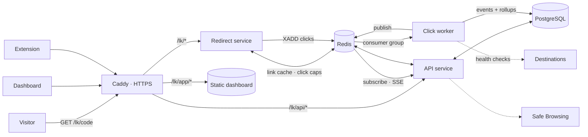

# LinkPulse

**Link management, redirection and click analytics in one connected flow.**

LinkPulse goes beyond "paste a URL, get a short URL". Every short link is a record that campaigns organise, redirect rules route, click events measure and admins govern — and a takedown stops redirects on the very next click.

**Live:** https://r2-d2.xyz/lk/app/ · short links look like `https://r2-d2.xyz/lk/diwali`

| Demo account | |
|---|---|
| Email | `demo@linkpulse.app` |
| Password | `pulse-demo-2026` |

---

## Features

**Links**
- Two-step creation wizard: destination and alias first, then campaign, tags, schedule, expiry, click cap, password, UTM parameters and device / OS / country targeting — with a validation review before publishing.
- Live alias availability with suggestions (`diwali` taken → `diwali-26`).
- URL safety: only http/https, no private or internal addresses (checked after DNS too), domain blocklist, optional Google Safe Browsing, loop and double-shortener detection, reachability check.
- Bulk CSV import with a row-by-row preview (valid / invalid / duplicate with reasons), background import with progress and a downloadable error report.
- QR codes in PNG and SVG; scans are tracked separately from clicks.
- Safe preview: add `+` to any short link to see where it goes before visiting.

**Redirect engine** — every request runs the same nine checks, in order:

| # | Check | Result when it fails |
|---|---|---|
| 1 | Look up the code (Redis, then Postgres) | 404 |
| 2 | Disabled by an admin | 410 safety page |
| 3 | Paused or archived | 410 |
| 4 | Not live yet | "not live yet" page |
| 5 | Expired | 410 |
| 6 | Click cap reached (atomic Redis counter) | 410 |
| 7 | Password protected | unlock page (5 tries / 15 min) |
| 8 | Targeting rules | pick destination |
| 9 | Log the click (stream, not awaited) | **302** |

302 rather than 301, so browsers never cache the redirect: every visit is counted and takedowns work immediately. On the production VM a cached redirect is answered in about 3 ms (measured with curl on the server; the target is under 50 ms at p95).

**Analytics**
- Clicks, unique visitors, bots filtered and QR scans, by period (24 h / 7 / 30 / 90 days) and campaign.
- Traffic sources, referrers, devices, browsers, operating systems, countries, recent clicks.
- Live dashboard over server-sent events.
- Alerts: near click cap, expiring soon, destination broken (health monitor), disabled, under review, traffic spikes.
- Bots (link previews, crawlers, HEAD and prefetch requests, click bursts) are logged but never counted and never use up a click cap. Unique visitors are a daily-salted SHA-256 of IP and user agent — no cookies, raw IPs are not stored.

**Governance**
- Roles: visitor, user, admin — checked in middleware and scoped in every query.
- Admin console: abuse-report queue, one-click disable / restore, platform-wide link search, domain blocklist (adding a domain pauses matching links), users, audit log.
- Auto-protect: three reports from different visitors pause a link until an admin reviews it.
- Rate limits (Redis token buckets) on sign-in, sign-up, link creation, imports and reports.
- Links are never hard-deleted, so disabled and expired links stay traceable in reports.

**Browser extension** (`apps/extension`) — right-click a link, a page or selected text, press `Alt+Shift+S`, or type `lp` in the address bar. The short link is copied with a QR code. See [apps/extension/README.md](apps/extension/README.md).

---

## Architecture



- **Fast path:** the redirect service reads the link from Redis, runs the nine checks and answers with a 302. It never waits for analytics.
- **Async path:** each click goes onto a Redis Stream. A worker in a consumer group enriches it (user agent, GeoLite2 country and city, source, bot flag, uniqueness), writes the event and the daily rollup, and publishes it for live dashboards. If the worker stops, events wait in the stream.
- **Cache:** link edits, pauses and admin takedowns delete the cached entry, so the next request sees the change.

More detail, including the data flow diagram and data model: [docs/architecture.md](docs/architecture.md). API reference: [docs/api.md](docs/api.md).

## Repository

```
apps/
  api/        Fastify API: auth, links, campaigns, analytics, imports, QR, admin, SSE
  redirect/   Fastify redirect service: rule engine, password unlock, preview, visitor pages
  worker/     Redis Streams consumer and link health monitor
  web/        Next.js dashboard (static export, TypeScript, Tailwind, Recharts)
  extension/  Chrome Manifest V3 extension
packages/
  core/       Pure logic with tests: rule engine, codes, URL and alias validation, bots, CSV, UTM
  db/         Prisma schema, migrations, seed
  runtime/    Shared config, Redis keys, link cache, rate limiter
deploy/       systemd units, Caddy route, release script
scripts/      Local gateway and smoke test
```

## Tech stack

Node.js 20 · Fastify · PostgreSQL 17 + Prisma · Redis (Streams, counters, token buckets) · Next.js 14 · TypeScript · Tailwind CSS · Recharts · ua-parser-js · isbot · geoip-lite (GeoLite2) · zod · papaparse · qrcode · nanoid · Chrome Manifest V3 · Caddy · systemd

## Run it locally

Requirements: Node.js 20+, PostgreSQL 14+ and Redis 6.2+.

```sh
npm install
cp .env.example .env          # set DATABASE_URL, SESSION_SECRET, ADMIN_PASSWORD
npm run db:generate
npm run db:migrate
npm run db:seed               # demo user, three campaigns, ~18 links, a month of clicks
npm test                      # rule engine, validation, bots, CSV, UTM

npm run dev:api               # :8441
npm run dev:redirect          # :8442
npm run dev:worker
npm run build:web && npm run gateway   # http://localhost:8440/lk/app/
```

The gateway mirrors the production routes so cookies and URLs behave the same as on the server. For dashboard development, run `npm run dev:web` instead of `build:web`; the gateway proxies to it.

End-to-end check against any deployment:

```sh
SMOKE_BASE=https://r2-d2.xyz/lk npm run smoke
```

## Deploy

On the server (Debian, with PostgreSQL, Redis, Node 20 and Caddy):

1. Create the database and user, then write `/etc/linkpulse/linkpulse.env` from `.env.example` with `NODE_ENV=production`.
2. Add `deploy/Caddyfile.snippet` to the site block and reload Caddy.
3. Upload a release archive (`git archive --format=tar.gz -o linkpulse.tar.gz HEAD`) and run `sudo sh deploy/release.sh linkpulse.tar.gz`. It installs dependencies, migrates the database, runs the tests, builds the dashboard and the extension zip, switches the `current` symlink and restarts the three services.
4. Seed once: `cd /opt/linkpulse/current && sudo -u linkpulse sh -c 'set -a; . /etc/linkpulse/linkpulse.env; npm run db:seed'`.

## Team Ubiquitous · Graphic Era Hill University

Krishna Pandey · Rahul Joshi · Ashutosh Singh · Mayank Kumar

## Credits

IP geolocation uses GeoLite2 data created by MaxMind, available from https://www.maxmind.com, through the `geoip-lite` package. Released under the [MIT License](LICENSE).
