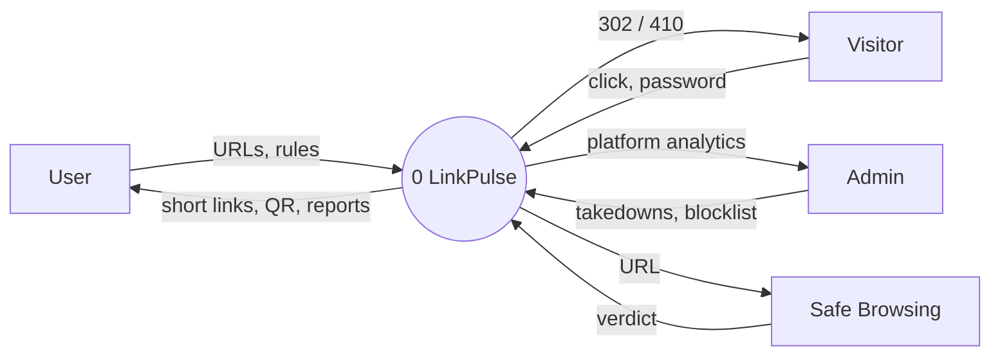
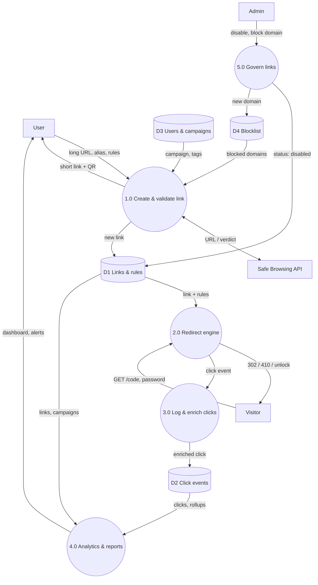

# Architecture

## Services

| Service | Port | Role |
|---|---|---|
| Redirect (`apps/redirect`) | 8442 | Short links, rule engine, password unlock, `+` preview, visitor status pages |
| API (`apps/api`) | 8441 | Auth and roles, links, campaigns, analytics, imports, QR codes, admin, server-sent events |
| Worker (`apps/worker`) | — | Click stream consumer (enrichment, uniques, rollups, live events) and the link health monitor |
| Dashboard (`apps/web`) | static | Next.js static export served by Caddy at `/lk/app` |
| PostgreSQL | 5432 | Source of truth |
| Redis | 6379 | Link cache, click-cap counters, click stream, live channel, rate-limit buckets |

## Request flow for one click

1. The visitor opens `https://r2-d2.xyz/lk/abc`. Caddy terminates HTTPS and proxies to the redirect service.
2. The redirect service reads `lp:link:abc` from Redis (falling back to Postgres and caching the result for ten minutes).
3. The rule engine (`packages/core/src/rules.js`) runs the nine checks in order.
4. For human visitors on capped links, `INCR lp:cap:<id>` reserves a click atomically; if it overshoots the cap it is undone and the visitor sees "limit reached".
5. The click is appended to the `lp:clicks` stream with `XADD`, without waiting, and the visitor gets a 302.
6. The worker reads the stream through the `click-workers` consumer group, parses the user agent, looks up the country and city, classifies the source, decides uniqueness with `SET NX` on a daily key, and writes `ClickEvent` and `ClickDaily` in one transaction.
7. The worker publishes the click on `lp:live`. The API relays it to dashboards over server-sent events.

## Data flow diagram — level 0

## Data flow diagram — level 1

## Data model

`packages/db/prisma/schema.prisma` is the source. The main relations:

- `User` ↔ `Workspace` through `WorkspaceMember`. Each user gets a personal workspace at sign-up.
- `Workspace` has `Folder`, `Campaign`, `Tag` and `Link`.
- `Link` is the hub: `RedirectRule[]` (targeting), `ClickEvent[]`, `ClickDaily[]` (rollups), `LinkTag[]`, `AbuseReport[]`.
- `codeLower` is unique, so aliases are case-insensitive.
- `status` is `ACTIVE | PAUSED | ARCHIVED | DISABLED`; `flagged` marks auto-protected links waiting for review. Links are never deleted.
- `ImportJob` / `ImportRow` keep every CSV row with its validation result.
- `ApiToken` stores SHA-256 hashes of personal access tokens.
- `AuditLog` records every admin action.

## Security notes

- Passwords (accounts and links) use bcrypt. Sessions are HS256 JWTs in an HTTP-only, `SameSite=Lax`, `Secure` cookie scoped to `/lk`.
- Link-unlock cookies are HMAC-signed, link-scoped and expire after 12 hours.
- SSRF: destinations are refused if the host is internal or private, and again if DNS resolves to a private address; validation requests never follow redirects.
- Every user-data query goes through `ownerScope()`, so a missing role check cannot leak another user's links.
- Rate limits are atomic Redis token buckets (a Lua script) and fail open if Redis is unavailable, so a cache outage never blocks sign-in.
